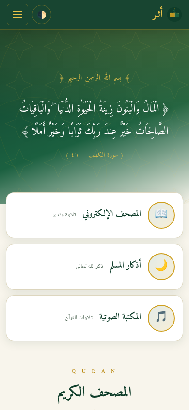
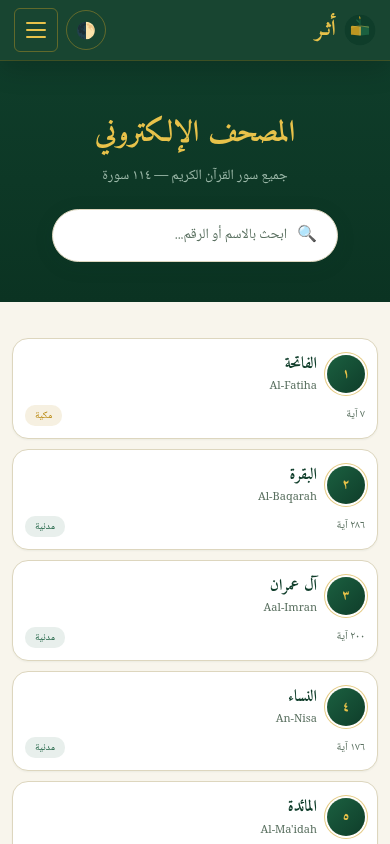
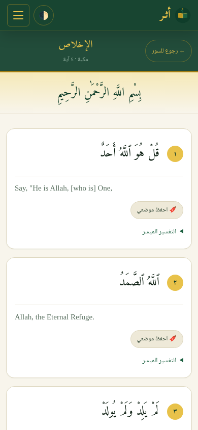
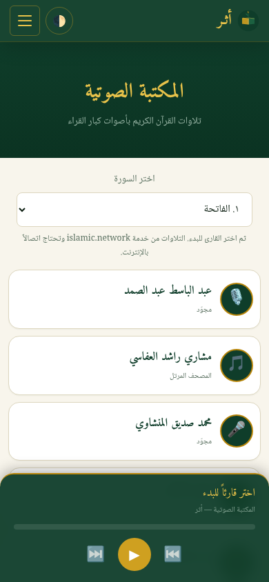

# Athar (أثر)

**Live demo: https://hexanr.github.io/Athar/**

Athar is a small Arabic, right-to-left Islamic web app built with plain HTML, CSS and JavaScript. No framework and no build step. It works on phones and desktops, with a light and a dark theme.

| Home | Quran | Surah with tafsir | Audio |
|---|---|---|---|
|  |  |  |  |

## What it does

- **Quran reader.** Lists all 114 surahs, with search. Opening a surah loads the Uthmani text, the Sahih International English translation and the Tafsir al-Muyassar (Arabic) from the public [Al-Quran Cloud API](https://alquran.cloud/api). Each verse has a "save my place" button, and the home page shows a "continue reading" button that returns you to it.
- **Daily azkar.** Morning, evening and sleep azkar, and supplications. Each zikr has a counter you can tap and reset.
- **Audio library.** Pick a surah and a reciter and it streams the full recitation from [islamic.network](https://islamic.network/developers/) (`cdn.islamic.network`). Play/pause, skip 15 seconds and a seek bar. If a file can't be loaded, the player shows an error message.
- **Dark mode.** Follows your system setting the first time, then remembers your choice.
- **Shareable links.** Hash routes work with the back button: `#/quran`, `#/quran/18`, `#/quran/18/3` (surah, ayah), `#/azkar`, `#/audio`. No sign-in, the site is fully public.

## Run it

Open `index.html` in a browser. An internet connection is needed for the Quran text, the tafsir and the audio.

## Structure

```
index.html       page markup
css/style.css    styles (light + dark theme, responsive)
js/app.js        Quran + tafsir API calls, azkar data, reciters, audio player, bookmark, hash router
screenshots/     images used in this README
```

## Notes

- The interface language is Arabic (`lang="ar" dir="rtl"`). English translation text is marked `lang="en" dir="ltr"`.
- Quran text, tafsir and audio come from third-party services, so the app depends on them being online.
- Saved data (reading position, theme) stays in your browser's `localStorage`.
